# Aufgaben vom 27. Oktober 2026

Kundenauftrag von Martin Brauns (E-Mail an class21). Bearbeitet am 8. November 2026.

**Ausgangsstand:** Commit `4f26d5a`, vollständig gesichert unter `~/1coding/bildung-im-freien-backup-2026-11-08-4f26d5a`.
**Stand der Umsetzung:** nur lokal im Repo, nicht committet und nicht veröffentlicht. Die Screenshots unten können als Bildvorlage für die Abstimmung mit dem Kunden dienen.
**Regel für Inhalte:** Es werden nur vorhandene Texte und wörtliche Sätze aus der Kunden-E-Mail verwendet. Keine eigenen Aussagen, Produktnamen oder Produktzuordnungen.

## Aufgaben laut E-Mail

1. Bitte drei Alternativvorschläge für das Logo „Miteinander im Freien“.
2. Die optische Wertung innerhalb der Hauptmenüleiste ist verkehrt: Produkte sind am wichtigsten.
3. Den neuen Menüpunkt „Über uns“ einfügen.
4. Dem Kunden sollen Referenzprojekte in einem Menüpunkt „Referenzen“ gezeigt werden. Bilder und Texte liefert der Kunde.
5. Kontakt und Impressum zusammenfassen, gehört ans Ende der Menüleiste.
6. Layout: Die Darstellung entfaltet sich bei der Produktübersicht über ca. 46 cm, die Menüleiste mit Logo über 32 cm und die Produktdarstellung über 28 cm. Wie wirkt das auf externe Betrachter? Sollte etwas geändert werden, und wenn ja, was?
7. Die Startseite soll neu gestaltet werden. Dem Besucher soll sehr schnell klar werden, was wir für welche Zielgruppe anbieten und warum wir der richtige Partner sind. Beispiel: Outdoormöbel und Beschattungen für das Lernen in Gruppen oder einfach für einen angenehmen Aufenthalt im Freien. Zielgruppe sind Schulen, Universitäten, Kommunen, Architekten und Landschaftsplaner. Wir sind die richtigen Partner, weil unsere Möbel gut gestaltet, funktional, robust und langlebig sind und wir passende Beschattungen mitliefern. Außerdem können wir bei Bedarf die Planung für Outdoor-Aufenthaltsbereiche übernehmen.
8. Besucher sollen sich einfach und schnell alle relevanten Informationen erschließen und leicht Kontakt aufnehmen können, per Telefon, E-Mail oder Projektmeldebogen. Für den Projektmeldebogen zwei Zugänge: ein Button „Meine Projektanfrage“ in der Hauptmenüleiste und über die Produktseiten, auf denen Nutzer Produkte konfigurieren und Preis-/Projektanfragen formulieren. Nutzern muss schnell klar sein, wie sie ihr Anliegen vorbringen können.

Zusätzlich vom Kunden: Angebot mit Kosten und Zeitraum. Designs zuerst bildhaft abstimmen, erst nach gemeinsamem Beschluss programmieren.

## Status

| # | Aufgabe | Status |
|---|---|---|
| 1 | Logo-Alternativen | zurückgestellt (interne Vorgabe) |
| 2 | Wertung Hauptmenü | umgesetzt |
| 3 | Über uns | umgesetzt, Text stammt von der alten Startseite |
| 4 | Referenzen | Seite steht, Texte und Produkte liefert der Kunde |
| 5 | Kontakt + Impressum | zusammengefasst, Link im Footer statt im Menü (interne Vorgabe) |
| 6 | Breiten | umgesetzt |
| 7 | Startseite | umgesetzt |
| 8 | Kontaktwege + Projektanfrage | umgesetzt |

## Umsetzung

### 1. Logo

Vorerst nicht bearbeitet.

### 2. Wertung der Hauptmenüleiste

- „Produkte“ ist jetzt die einzige gefüllte Schaltfläche und steht vorn, in gleicher Größe wie die anderen Menüpunkte. Vorher war es einfacher Text neben zwei orangen Schaltflächen.
- „Meine Projektanfrage“ ist zweitrangig (nur Rahmen), „Broschüren“ ist einfacher Text.
- Reihenfolge: Produkte, Referenzen, Über uns, Broschüren, Meine Projektanfrage.
- Die Produktübersicht öffnet per Hover und per Klick und schließt, sobald die Maus Button und Übersicht verlässt.
- Das Menü steht auf allen Seiten direkt im HTML, nicht mehr teilweise per JavaScript. So springt es beim Laden nicht.

| Vorher | Nachher |
|---|---|
| 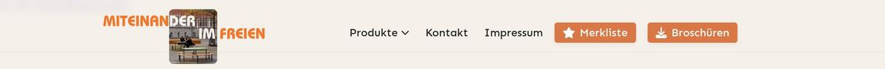 | 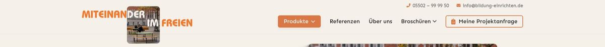 |
| 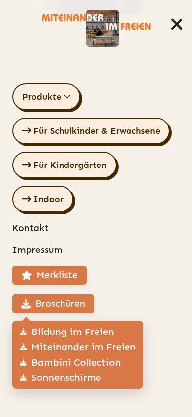 | 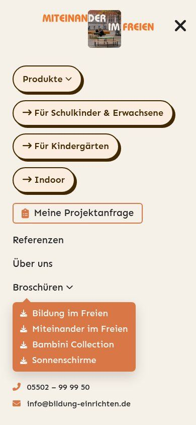 |

### 3. Über uns

Neue Seite `ueber-uns.html`. Sie übernimmt wortgleich von der alten Startseite den vollständigen Text „Wer wir sind – unsere Vision“. Das Bild war schon in der Galerie der Startseite.

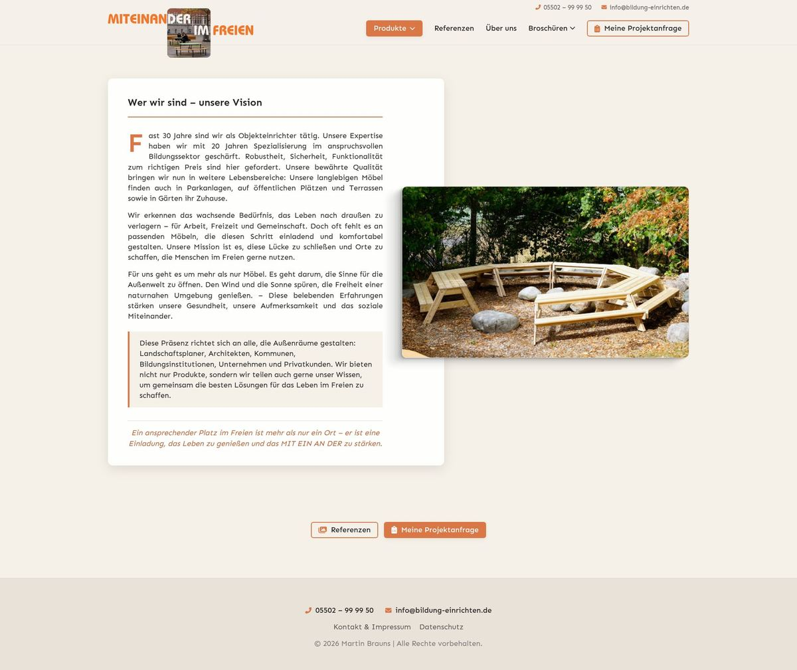

### 4. Referenzen

- Neue Seite `referenzen.html`: 19 Projekte mit Ort und Einrichtung (aus den Ordnernamen). Ein Klick öffnet alle Fotos des Projekts.
- 71 ausgewählte Fotos, verkleinert von 1,9 GB Gesamtmaterial auf 30 MB unter `bilder/referenzen/`.
- Keine Produktnamen und keine Texte, bis der Kunde sie liefert. Sie kommen in `js/referenzen.json` in die Felder `produkte` und `text` und erscheinen dann automatisch.
- **Personen:** Die bekannten Fotos und zwei weitere (Mülheim `P_20260423_140809`, Doveren `_DSC0134`) wurden nicht verwendet. Bei Lauf (2 Fotos), Brachelen und Hilfarth sind Personen hinter oder in Fensterscheiben unkenntlich gemacht.

| Übersicht | Fotoansicht |
|---|---|
| 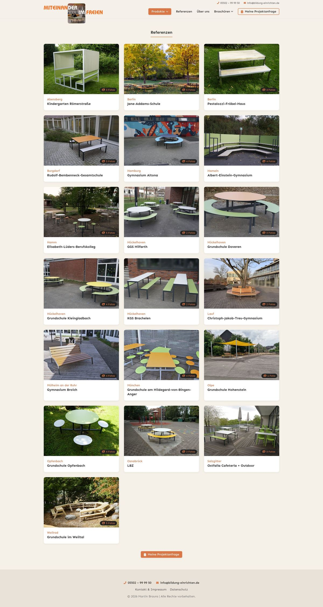 | 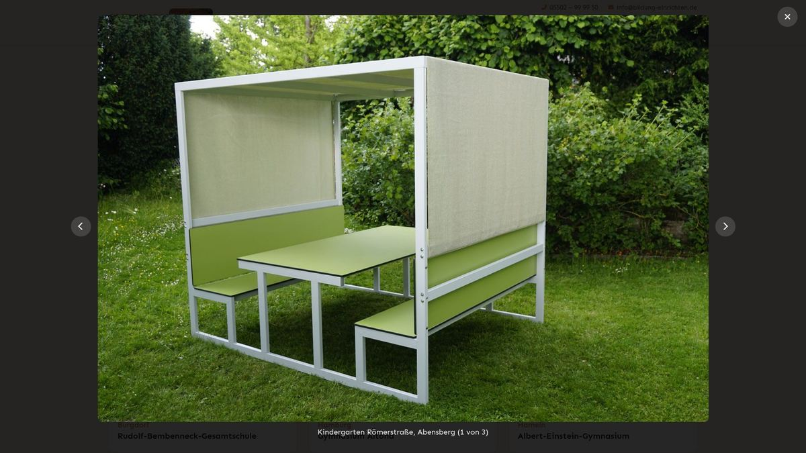 |

### 5. Kontakt und Impressum

- Eine gemeinsame Seite `kontakt.html`, erreichbar über „Kontakt & Impressum“ in der Fußzeile jeder Seite. Datenschutz hat dort einen eigenen Link.
- **Abweichung von der E-Mail:** Der Kunde wollte den Punkt ans Ende der Menüleiste, intern wurde die Fußzeile festgelegt.
- `impressum.html` leitet für alte Links auf `/kontakt.html#impressum` weiter.

| Vorher | Nachher |
|---|---|
| 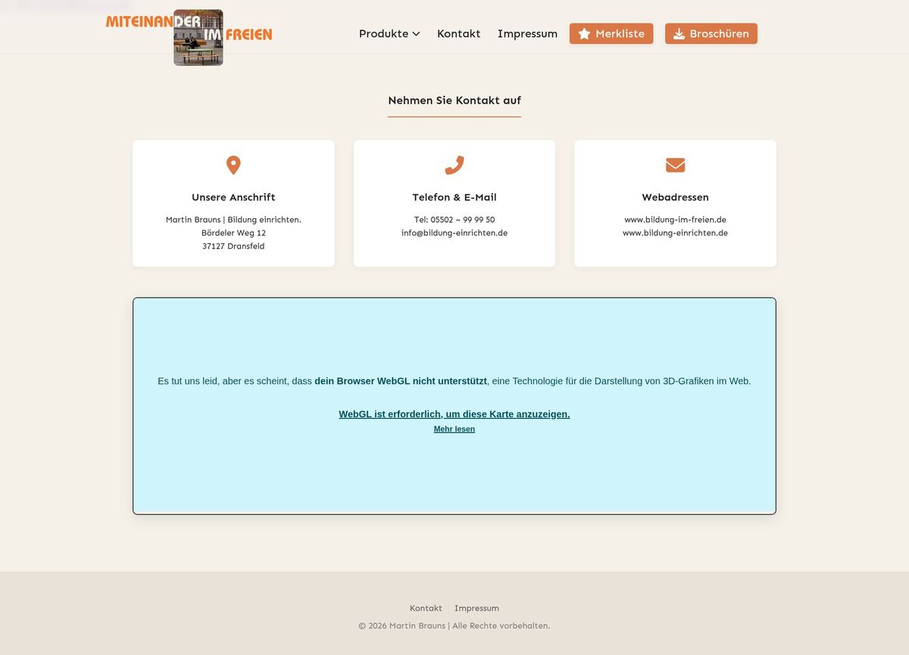 | 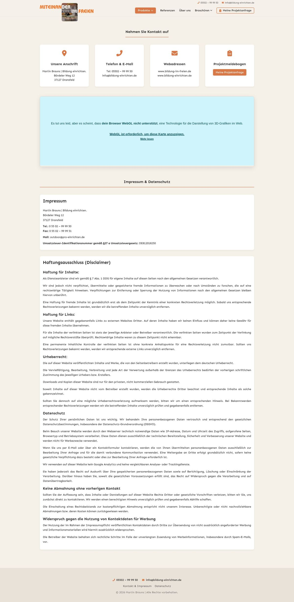 |

### 6. Breiten von Layout, Menü und Produktdarstellung

**Einschätzung:** Die drei unterschiedlichen Breiten wirken auf großen Bildschirmen unruhig. Es gab keine gemeinsame Kante, das Logo ragte links aus dem Inhalt heraus, und die Produktdarstellung nutzte den Platz am wenigsten. Gemessen bei 1920 px: 1880 px (Produktübersicht), 1376 px (Menü mit Logo), 1200 px (Inhalt). Das entspricht etwa den 46, 32 und 28 cm des Kunden.

**Änderung:** Eine gemeinsame Breite von 1400 px Inhalt (rund 34 cm auf dem Kundenbildschirm) für Kopfzeile, Produktübersicht und alle Seiten, gesteuert über `--layout-width` in `css/style.css`. Logo und Menü schließen bündig mit dem Inhalt ab. Die Produktübersicht bleibt jetzt vollständig im Bild und scrollt innen, falls der Bildschirm niedrig ist.

| Vorher | Nachher |
|---|---|
| 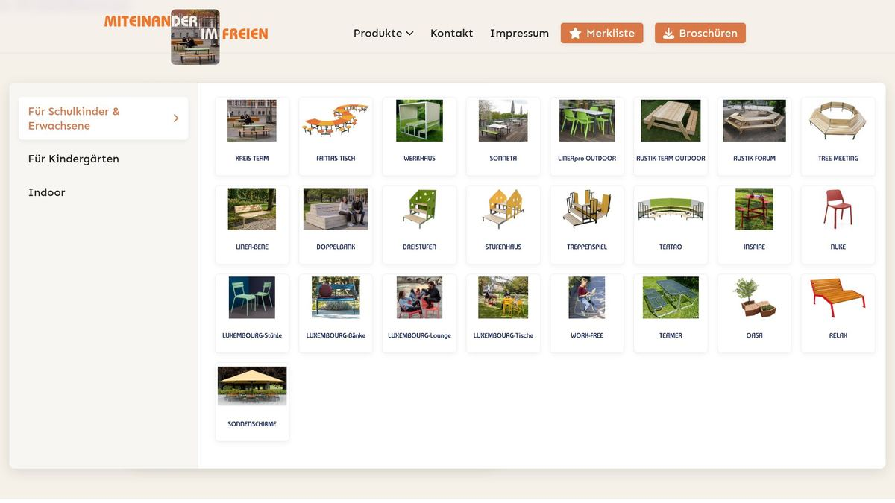 | 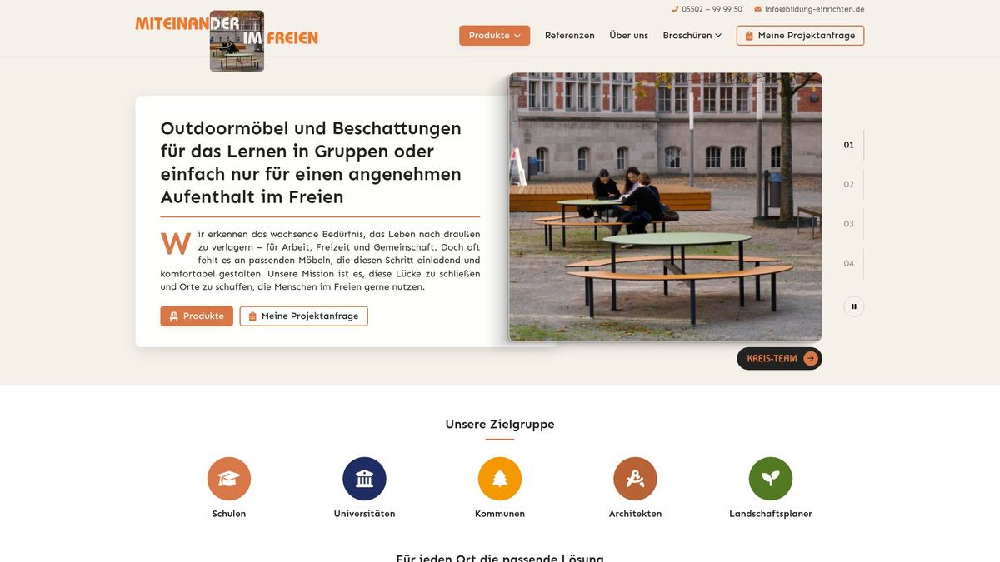 |
| 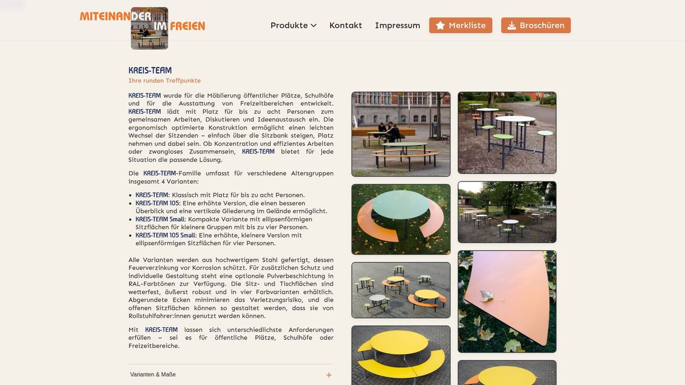 | 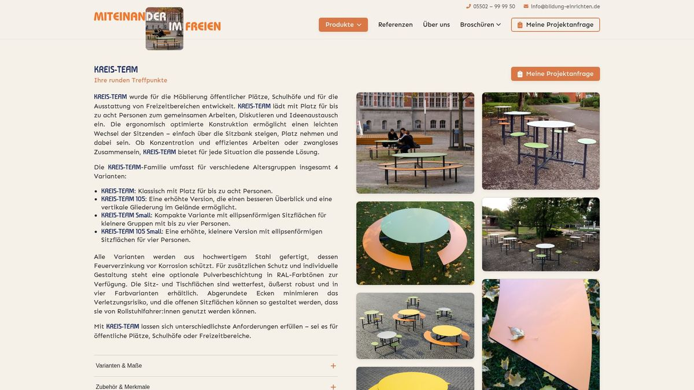 |

### 7. Startseite

- Oben steht wörtlich aus der E-Mail, was wir anbieten. Darunter wie auf der alten Startseite ein Absatz aus „Wer wir sind“ und die Buttons „Produkte“ und „Meine Projektanfrage“.
- „Unsere Zielgruppe“ mit den fünf genannten Gruppen und die alten Karten „Für jeden Ort die passende Lösung“ stehen in einem Abschnitt. Direkt darunter „Wir sind die richtigen Partner“ mit den drei Aussagen der E-Mail, nur grammatisch in Einzelsätze getrennt.
- „Wer wir sind – unsere Vision“ als Kurzfassung (erste Sätze und Zitat der alten Startseite, wortgleich) mit einer Bildergalerie aus fünf vorhandenen Produktfotos zum Durchklicken und Links zu Über uns und Referenzen.
- „Unser Versprechen“, LUXEMBOURG und die Galerie sind wie im Original. Einzige Textkorrektur: Tippfehler „inspirierende“.
- Am Seitenende steht der Kontaktblock mit Telefon, E-Mail und Projektmeldebogen.
- Der Slider oben wechselt alle 5 Sekunden, auch mit der Maus auf dem Bild und nach Klick auf eine Nummer. Nur der Pause-Button stoppt ihn.

| Vorher | Nachher |
|---|---|
| 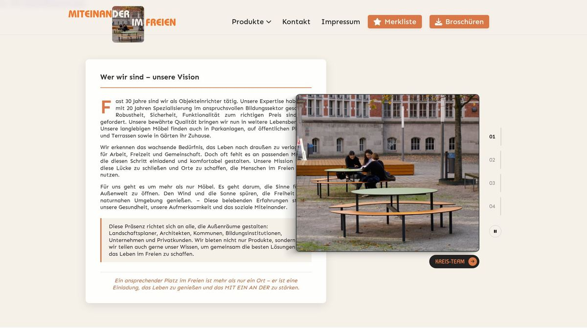 |  |
| 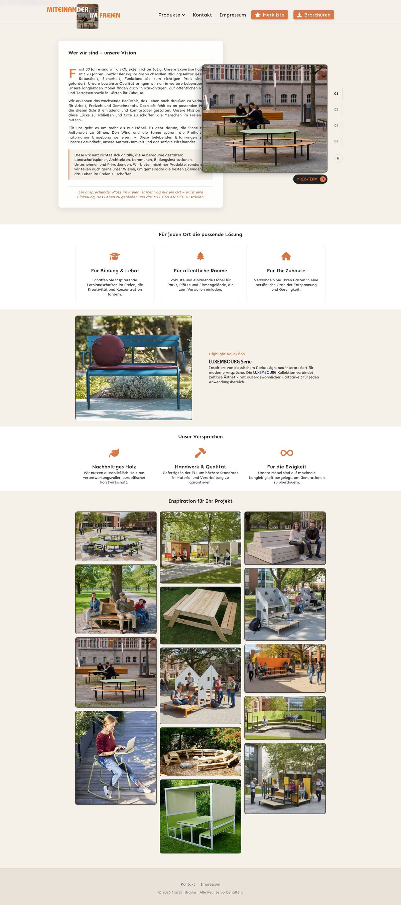 | 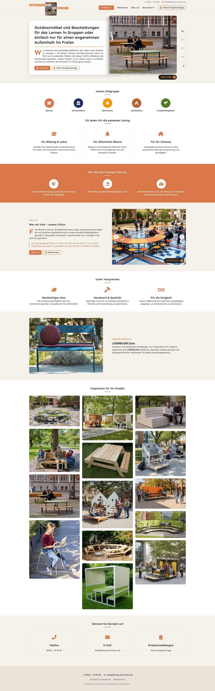 |
| 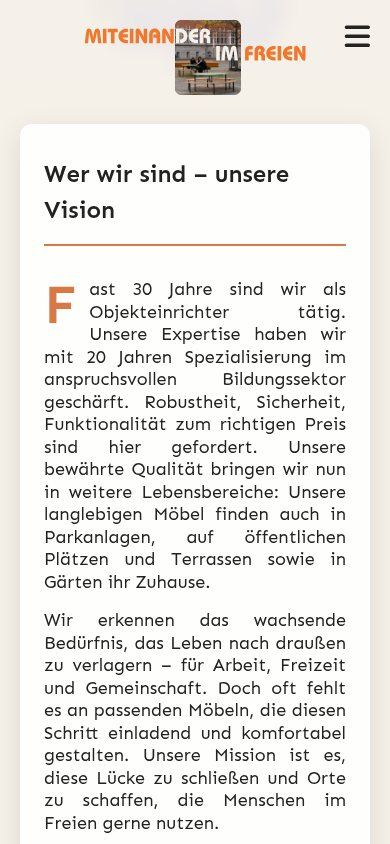 | 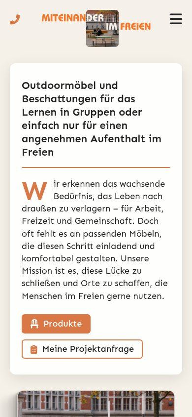 |

### 8. Kontaktwege und Projektanfrage

- Telefon und E-Mail stehen auf jeder Seite oben rechts und in der Fußzeile. Mobil gibt es ein Telefon-Symbol zum Antippen.
- „Merkliste“ heißt jetzt „Meine Projektanfrage“, die Seite `projektanfrage.html` (vorher `merkliste.html`, war nie live).
- Das Formular funktioniert jetzt auch ohne ausgewählte Produkte. Dann ist „Ihr Anliegen“ Pflichtfeld. Die Regel steht in `js/merkliste.js` und `anfrage.php`.
- `anfrage.php` ist abgesichert (S-01, S-03, S-11): sichere Antwortadresse, Spam-Falle, Mindestdauer 3 Sekunden, höchstens 5 Mails pro Stunde und IP, Größen- und Herkunftsprüfung.
- Produktseiten: oben ein Button „Meine Projektanfrage“ als Sprung, unter dem Konfigurator drei kurze Schritte, nach dem Hinzufügen ein Link „Meine Projektanfrage“.
- Neue kurze Bedientexte: „Zu meiner Projektanfrage hinzufügen“, „Zur Projektanfrage hinzufügen“, „Produkt auswählen“, „Noch keine Produkte ausgewählt.“, „Ihr Anliegen“. Alles andere verwendet vorhandene Wörter oder die der Kunden-E-Mail.

| Vorher | Nachher |
|---|---|
| 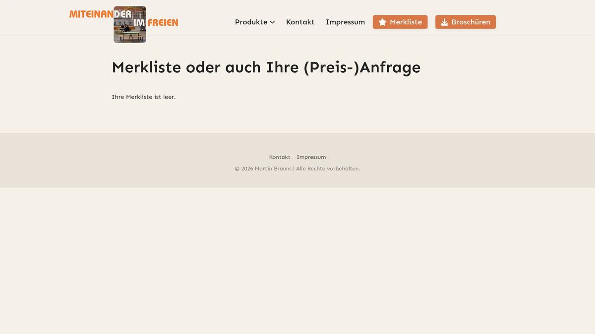 | 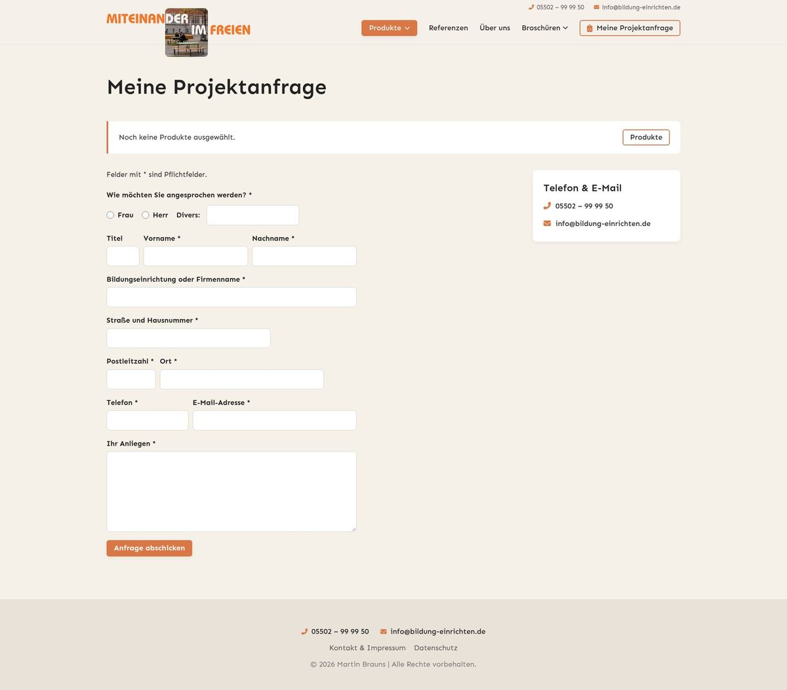 |
|  |  |

Formular mit gewähltem Produkt:

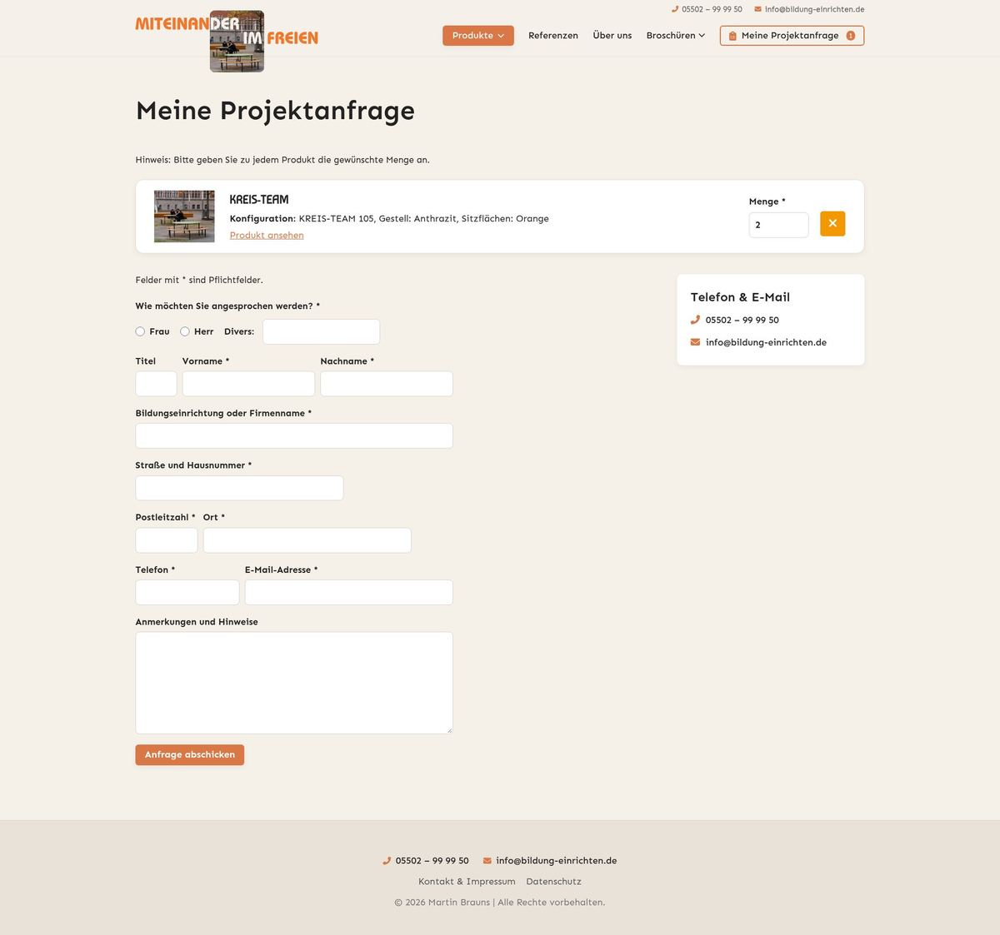

### Design (interne Vorgabe, nur leichte Eingriffe)

- Ruhiger: dünne helle Bildrahmen statt dunkler 2-px-Rahmen, mehr Abstand zwischen den Abschnitten, etwas höherer Zeilenabstand, Galerie wieder in 3 Spalten, Logo und Menü auf allen Desktop-Breiten gleich groß.
- Lebendiger: orange Partner-Fläche, farbige Symbole bei den Zielgruppen, kleine Akzentlinien unter den Überschriften, sanfter Bild-Zoom im Slider. Die ursprünglichen Hover-Effekte und der gestaffelte Bildschatten sind wieder da.

### Responsive (interne Vorgabe)

Geprüft auf 16 Bildschirmgrößen von 320 bis 2560 px, dazu Handy quer, automatisch und als Bild.

- **Behoben, Überstände:** Bei 320 und 390 px ragten Produktseiten, Startseite und Kontaktseite über den Rand. Breite Maßtabellen scrollen jetzt innerhalb ihrer Karte.
- **Behoben, Tablet:** Galerie zweispaltig statt riesiger Einzelbilder, Bild und Text bis 768 px nebeneinander, keine verwaisten Einzelkarten mehr.
- **Behoben, Handy:** Linksbündiger Text statt Blocksatz mit großen Lücken, größere Tippflächen, Produktliste im Menü zweispaltig, langer Menü-Button bricht um.
- **Behoben, Touch:** Produktnamen in der Galerie sind ohne Hover sichtbar, Broschüren öffnen per Tippen, Konfigurator ist auf Handys quer nicht mehr höher als der Bildschirm.

## Prüfung

Automatisch im Browser geprüft: alle 38 Seiten (einheitliches Menü, keine Fehler, keine Überbreite von 320 bis 2560 px), 121 interne Links, Produkt hinzufügen, Formular mit und ohne Produkte, Produktübersicht, Mobilmenü, Fotoansicht, Weiterleitung.

- **Konfigurator:** Auf 4 Produkten geladen, er füllt die neue Breite, die Auswahl landet in der Anfrage. Die Darstellung ist per Software-Rendering nicht als Bild prüfbar, also bitte einmal im normalen Browser ansehen.
- **Responsive:** nur in Chromium mit Geräte-Emulation geprüft, nicht auf echten Geräten (vor allem iPhone/Safari einmal ansehen).
- **Formular:** 33 Serverfälle und der komplette Weg vom Browser bis zur fertigen Mail bestanden, mit und ohne Produkte (PHP 8.5 als WebAssembly). Dabei war der Versandbefehl durch einen Platzhalter ersetzt, es wurde keine echte Mail verschickt.

## Offene Punkte

1. **Kundenfreigabe** der Entwürfe steht aus (der Kunde wollte Designs zuerst als Bild sehen).
2. **Mailversand auf dem Server testen:** Die Zustellung über IONOS lässt sich nur dort prüfen. Dafür in `anfrage.php` `$recipient` kurz auf eine eigene Adresse setzen und danach zurückstellen. Vor dem Go-live außerdem HTTPS erzwingen (S-02) und die Datenschutzerklärung ergänzen (S-14).
3. **Referenzen mit dem Kunden klären:** Texte, Produkte je Projekt, Erlaubnis zur Namensnennung der Einrichtungen, ausgeschriebener Name von „LBZ“, Bilder mit unkenntlichen Fensterflächen.
4. **Mit dem Kunden klären:** „Kontakt & Impressum“ steht abweichend von der E-Mail im Footer. Die Karte „Für Ihr Zuhause“ auf der Startseite spricht Privatkunden an, die die E-Mail nicht als Zielgruppe nennt.
5. **E-Mail-Adressen:** Im Impressum steht `outdoor@pro-einrichten.de`, sonst `info@bildung-einrichten.de`. Beide stehen jetzt auf derselben Seite.
6. **Footer-Logo** ist uneinheitlich: Auf 4 Seiten lädt es nicht (alte WordPress-Adresse), auf 31 Produktseiten fehlt es, auf 3 Seiten ist es vorhanden. Wegen des zurückgestellten Logo-Themas nicht geändert.
7. **Angebot** mit Kosten und Zeitraum an den Kunden steht noch aus.
8. **Telefonfeld** akzeptiert weiterhin nur Ziffern. „05502 / 99 99 50“ wird abgelehnt, das sollte gelockert werden.
